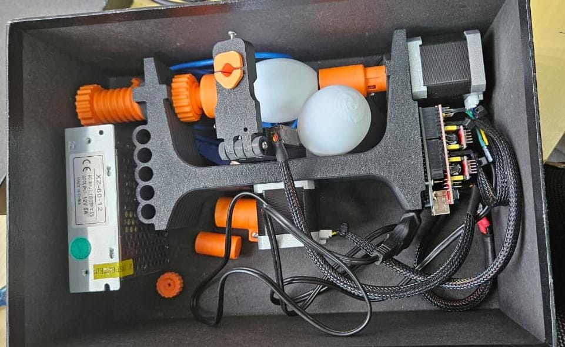
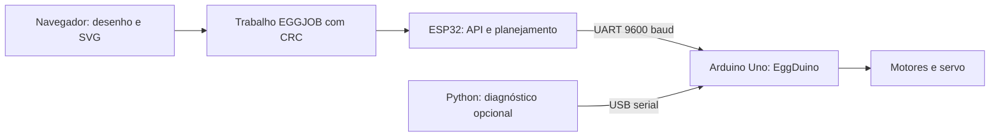

# EggBot IoT Plotter · Egg Studio

Desenhe no navegador, visualize o traço na superfície de um ovo e prepare um trabalho para o EggBot. O projeto reúne uma interface em **React + Tailwind**, um controlador web para **ESP32** e o firmware **EggDuino para Arduino Uno**.


[](docs/capa.jpeg)

## Sobre o projeto

O objetivo é transformar o EggBot em um plotter IoT para superfícies ovais: desenhar ou enviar uma imagem pelo celular, preparar a trajetória, visualizar o resultado e acompanhar a execução no ovo. O EggBot e o EggDuino fornecem a base mecânica e o controle dos motores; este projeto desenvolve a interface, o processamento e a comunicação entre as partes.

A meta é operar pela rede local do ESP32 sem manter um computador conectado ao robô. Atualmente, a interface React permite desenho livre e importação de contornos SVG. A vetorização de imagens raster e a instalação do build React no ESP32 ainda são etapas futuras.

## Comece pela interface

Use Node.js 22.12+ na linha 22, ou uma versão compatível indicada em `interface_web/package.json`.

```bash
git clone https://github.com/GuilhermeRds1921/Egg-Bot.git
cd Egg-Bot/interface_web
npm ci
npm run dev
```

Abra o endereço mostrado no terminal, normalmente `http://localhost:5173`.

Por padrão, o estúdio funciona em **modo demonstração**, sem equipamento conectado. Desenho livre, padrões, importação SVG, download de trabalhos, prévia do ovo e controles de impressão podem ser explorados no simulador.

Para abrir pelo celular na mesma rede do computador, execute `npm run dev -- --host 0.0.0.0` e use o endereço de rede mostrado pelo Vite.

## Funcionamento



O firmware ESP32 já contém uma interface embarcada anterior. A nova interface React usa o mesmo contrato de API e pode acessá-lo pelo proxy do servidor de desenvolvimento. **O build React ainda não é incorporado ao firmware**; essa integração é uma etapa posterior. Veja as [instruções da interface](interface_web/README.md#conexão-com-o-esp32).

As responsabilidades estão divididas em três partes:

- **Interface e plotagem:** edição dos traços, importação SVG, simplificação, prévia e geração do trabalho `EGGJOB 1` com CRC.
- **ESP32:** rede Wi-Fi, API, recebimento do trabalho, planejamento e envio dos comandos ao Uno.
- **Arduino Uno + EggDuino:** execução dos comandos e acionamento dos motores e do servo da caneta.

O fluxo atual usa `EGGJOB 1` e comandos do protocolo EggDuino. Não há geração de G-code implementada.

A prévia é ilustrativa. O resultado físico depende da calibração, da mecânica e da forma do ovo. Os testes automatizados não substituem a validação no equipamento.

## Estrutura

```text
Egg-Bot/
├── interface_web/                  Aplicação React, testes e simulador
│   └── legacy/                    Prévia HTML anterior, preservada
├── firmware/
│   ├── esp32/eggbot_etapa5/        API, planejamento e página embarcada
│   └── uno/EggDuino/              Acionamento dos motores e servo
├── preplotter/                    Ferramenta Python de diagnóstico por USB
├── exemplos_padroes.py             Exemplos dos geradores Python
├── requirements.txt               Dependência do pré-plotter
├── eggbot.py / eggbot_conf.py      Driver independente do Inkscape
├── docs/                          Análises, proposta, relatório e imagens
└── .github/workflows/ci.yml        Verificações automáticas
```

## Ferramenta Python opcional

`preplotter/` foi mantido para diagnóstico de bancada. Não é dependência da interface React nem do caminho ESP32 → Uno.

Na raiz do repositório:

```bash
python3 -m venv .venv
source .venv/bin/activate
python3 -m pip install -r requirements.txt
python3 -B -m preplotter.main --help
python3 -B exemplos_padroes.py
```

No Windows, ative o ambiente com `.venv\Scripts\activate`. Os exemplos acima não movimentam o hardware. A CLI só executa movimentos com `--run`; sem essa opção, exibe um aviso, sem gerar uma prévia.

Consulte o [guia do pré-plotter](preplotter/README.md) antes dos testes com a máquina. O driver Inkscape da raiz é um caminho separado e requer dependências que não estão em `requirements.txt`.

## Verificação

Na pasta `interface_web/`:

```bash
npm test
npx playwright install chromium
npm run test:e2e
npm run build
```

Na raiz, confira os links dos documentos com `python3 scripts/check_docs.py`.

O workflow de CI executa instalação reproduzível, testes de dados e navegador, build da interface, verificação dos links e execução do Python sem hardware. Ele não publica um site, grava placas ou aciona motores.

## Estado atual

- Interface React responsiva, geração `EGGJOB 1`, SVG, prévia e controles implementados.
- Build e testes da interface disponíveis para execução local e na CI.
- Firmware ESP32 recebido e preservado, com configuração, upload e controle da impressão.
- Firmware Uno e ferramenta Python mantidos para integração e diagnóstico.
- Validação da interface React no hardware e correções do executor pendentes; veja a [análise de arquitetura](docs/ANALISE_ARQUITETURA.md).

## Próximas etapas

- Processar imagens raster e vetorizar contornos em trajetórias.
- Refinar a adaptação geométrica e a calibração para diferentes superfícies ovais.
- Integrar a distribuição da interface React ao ESP32 para uso independente do computador.
- Validar a comunicação e a execução completa no equipamento, incluindo as pendências do executor.

## Documentação

- [Interface React: desenvolvimento e conexão](interface_web/README.md)
- [Firmwares: organização e preparação](firmware/README.md)
- [Pré-plotter: diagnóstico por USB](preplotter/README.md)
- [Índice dos documentos e levantamentos históricos](docs/README.md)
- [Como contribuir](CONTRIBUTING.md)

## Créditos

O projeto usa os trabalhos [EggDuino de plex3r](https://github.com/plex3r/EggDuino) e [EggBot de Evil Mad Scientist](https://github.com/evil-mad/EggBot), além das bibliotecas distribuídas com seus fontes. Os avisos de autoria e licença originais foram preservados. Consulte [THIRD_PARTY.md](THIRD_PARTY.md) para localizar essas informações.

Referências de montagem: [vídeo](https://www.youtube.com/watch?v=F3q-DkTBnXs) e [modelo mecânico](https://www.thingiverse.com/thing:3431363).
