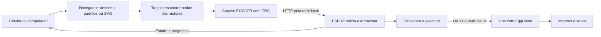

# Egg-Bot — levantamento dos códigos e análise para evolução da arquitetura

> **Levantamento histórico, anterior à interface React e à reorganização para o GitHub.** As árvores, pendências e descrições abaixo registram aquela revisão. Para o estado atual, consulte o [README principal](../README.md) e o [índice de documentação](README.md). Os links para arquivos foram ajustados aos caminhos atuais.

**Data:** 21/11/2026.
**Objetivo:** registrar a revisão do código antigo e das contribuições novas para orientar a definição da arquitetura do projeto.

Este documento descreve o conteúdo local analisado. Distingue comportamento observado no código, verificações executadas sem hardware, riscos inferidos e propostas futuras. Não representa certificação de funcionamento da montagem nem informa qual firmware está efetivamente instalado nas placas.

Nenhum código de aplicação ou firmware foi alterado durante o levantamento. Este arquivo registra os resultados; as correções propostas ainda precisam ser implementadas e verificadas.

## 1. Conclusão principal

O projeto já possui uma implementação do fluxo **celular → ESP32 → Arduino Uno → motores e servo**. Os códigos novos avançaram além do cenário descrito no `README_GPT.md` de setembro: existem interface web, desenho por toque, importação SVG, transferência de trabalhos, configuração, calibração manual e controle da impressão.

A evolução deve partir dessa base, separando suas responsabilidades e corrigindo a coordenação entre os comandos e o movimento físico. O pré-plotter Python pode continuar como ferramenta de bancada e referência; ele não é necessário no caminho principal implementado pelo ESP32.

## 2. Escopo e fontes locais

Foram examinados os módulos Python, o firmware EggDuino e seus componentes de comunicação/movimento, o firmware ESP32, a interface embutida, a prévia com simulador e a documentação fornecida.

| Fonte | Papel no levantamento |
| --- | --- |
| [preplotter/](../preplotter/main.py) | Fluxo Python de planejamento e comunicação serial |
| [exemplos_padroes.py](../exemplos_padroes.py) | Demonstrações dos padrões e estimativas |
| [eggbot.py](../eggbot.py) e [eggbot_conf.py](../eggbot_conf.py) | Caminho independente do Inkscape |
| [EggDuino-master/](../firmware/uno/EggDuino/EggDuino.ino) | Protocolo e execução no Uno |
| [eggbot_web/](../firmware/esp32/eggbot_etapa5/eggbot_etapa5.ino) | Firmware ESP32, interface e simulador |
| [eggbot_etapa5_web/eggbot_etapa5/](../firmware/esp32/eggbot_etapa5/eggbot_etapa5.ino) | Segunda cópia do código web/ESP32 |
| [SPEC da etapa 5](../firmware/esp32/eggbot_etapa5/SPEC-etapa5-configuracao-interface.md) | Intenção e critérios descritos para a implementação nova |
| [Proposta de projeto](<propostas de projeto.tex>) | Objetivos, arquitetura pretendida, cronograma e riscos |
| [Relatório final em PDF](Relatório_Final___Oficina.pdf) | Estado da documentação acadêmica; texto extraído para leitura |
| [README.md](../README.md), [README do pré-plotter](../preplotter/README.md) e [README_GPT.md](README_GPT.md) | Documentação existente, comparada com o código atual |

## 3. Estrutura encontrada

```text
Egg-Bot/
├── README.md
├── README_GPT.md                         Levantamento anterior, de setembro
├── ANALISE_ARQUITETURA.md                Este documento
├── requirements.txt                     Atualmente contém Markdown
├── eggbot.py                            Driver Inkscape
├── eggbot_conf.py                       Configuração do driver Inkscape
├── exemplos_padroes.py                  Exemplos Python
├── preplotter/
│   ├── __init__.py
│   ├── main.py                          CLI e coordenação
│   ├── planner.py                       Deltas e duração
│   ├── patterns.py                      Padrões geométricos
│   ├── eggduino.py                      Transporte serial
│   ├── README.md
│   └── __pycache__/                     Bytecode gerado, também presente no Git
├── EggDuino-master/
│   ├── EggDuino.ino                     Configuração e loop do Uno
│   ├── Functions.ino                    Comandos EBB
│   ├── Helper_Functions.ino             Motores, servo/EEPROM e respostas
│   ├── AccelStepper.h / .cpp            Biblioteca de movimento
│   ├── SerialCommand.h / .cpp           Parser serial
│   ├── button.h                        Botões opcionais
│   ├── README.md
│   ├── VersionHistory.txt
│   └── LICENSE.md
├── eggbot_web/
│   ├── eggbot_etapa5.ino                Firmware ESP32, 1274 linhas
│   ├── pagina.h                        HTML/CSS/JS embutidos, 351 linhas
│   ├── previa-pagina-etapa5.html        Interface com simulador, 436 linhas
│   └── SPEC-etapa5-configuracao-interface.md
├── eggbot_etapa5_web/
│   └── eggbot_etapa5/                   Cópia idêntica dos quatro arquivos acima
├── propostas de projeto.tex
├── Relatório_Final___Oficina.pdf
├── capa.jpeg
├── imagem02.jpeg
└── .gitmessage
```

### Duplicação e estado do Git

Os quatro arquivos de `eggbot_web/` são idênticos, byte a byte, aos correspondentes em `eggbot_etapa5_web/eggbot_etapa5/`. A comparação por SHA-256 confirmou a igualdade. Não são duas versões com funcionalidades distintas.

Na revisão, o Git indicava como não rastreados: as duas pastas web, `EggDuino-master/`, `README_GPT.md`, o PDF e o arquivo `.tex`. Os dois READMEs já tinham alterações locais da documentação anterior. Esses conteúdos não devem ser presumidos disponíveis em um clone do estado já versionado.

É necessário escolher uma localização oficial para o firmware ESP32 e evitar futuras alterações divergentes nas cópias. Nenhuma cópia foi removida. A pasta interna `eggbot_etapa5/` já corresponde ao nome do sketch principal, conforme a organização descrita pela SPEC.

## 4. As três linhas de execução

### 4.1. Pré-plotter Python

```text
CLI → padrão ou linha → LinePlanner → EggDuinoSerial → USB serial → Uno
```

- `main.py`: interpreta argumentos, prepara a conexão, escolhe teste/padrão/linha, executa segmentos e finaliza a conexão.
- `patterns.py`: gera `LineSegment(start_rotation, start_arm, end_rotation, end_arm, speed)`.
- `planner.py`: calcula deltas, distância euclidiana em passos e duração; retorna `MoveCommand(rotation_steps, arm_steps, duration_ms)`.
- `eggduino.py`: envia `v`, `EM` e `SM`; espera uma linha de resposta e usa espera temporal após o movimento.
- `exemplos_padroes.py`: imprime exemplos de geração e estimativas; não executa movimentos.

As coordenadas são passos de comando, não pixels, milímetros ou XYZ. O comando serial usa **braço antes de rotação**, embora a estrutura do planejador apresente rotação primeiro.

Sem `--run`, a CLI apenas mostra um aviso e termina. Esse caminho não planeja o desenho nem gera uma prévia, apesar do nome “simulação” nos logs.

### 4.2. Driver Inkscape

```text
SVG e opções da extensão → eggbot.py → bibliotecas plotink → serial → Uno/placa compatível
```

`eggbot.py` é independente do pacote `preplotter/`. Percorre o SVG, trata transformações, converte formas em caminhos, subdivide curvas, controla transições da caneta e mantém dados de progresso no documento. Também contém seleção de camadas, inversão de motores e pausa/retomada.

Depende de componentes externos como `lxml`, `plot_utils_import`, `plotink`, `ink_extensions` e `ink_extensions_utils`. Instalar apenas PySerial não prepara esse caminho.

`eggbot_conf.py` define a página de referência `3200 × 800`, `STEP_SCALE = 2` e `MIN_GAP = 1.0`. Essas configurações não são importadas pelo pré-plotter nem pelo código web.

### 4.3. Interface web e ESP32



O ESP32 cria uma rede `EggBot-XXXX` e configura o endereço `192.168.4.1`. A página é servida a partir de `PAGINA`, em `PROGMEM`, por `WebServer`; não é carregada do LittleFS. O LittleFS guarda o trabalho, enquanto `Preferences` guarda a configuração no NVS.

O navegador faz o processamento inicial. O ESP32 recebe trajetórias já expressas em coordenadas dos motores, converte posições absolutas em movimentos relativos e gerencia a transmissão. O Uno gera os pulsos e aciona o servo.

## 5. Funcionalidades presentes no código novo

### Navegador

- Abas Criar, Imprimir e Configuração; última aba registrada em `localStorage`.
- Desenho por toque/mouse, desfazer e limpar.
- Padrões: estrela, círculo, quadrado, senoide, duas senoides e hélice de duas voltas.
- Importação dos contornos de `path`, `line`, `polyline`, `polygon`, `rect`, `circle` e `ellipse` de SVG.
- Amostragem por geometria do navegador e transformação de coordenadas.
- Simplificação Ramer–Douglas–Peucker e ajuste de pontos aos limites configurados.
- Construção e envio do arquivo; visualização do arquivo local ou armazenado no ESP32.
- Prévia projetada sobre uma forma de ovo, com rotação da vista.
- Acompanhamento periódico de estado, progresso estimado, log e configuração.
- Comandos manuais de motores/caneta e console EBB.

A hélice web tem rotação de duas voltas e avanço linear do braço. Ela não reproduz exatamente `PatternGenerator.spiral()`, que soma uma oscilação senoidal a uma rampa do braço. Os padrões também diferem em escala e alguns parâmetros; não devem ser tratados como resultados numericamente equivalentes.

### ESP32

- Access point Wi-Fi e servidor HTTP local.
- Upload em blocos, limite de 64 KiB, validação do formato e CRC-32.
- Um trabalho persistido em `/job.txt`; `/job.tmp` recebe o upload antes da substituição.
- Leitura incremental do arquivo e conversão em comandos, sem carregar todo o trabalho na RAM.
- Filas de comandos da impressão, finalização e configuração.
- Estados `idle`, `running`, `paused`, `stopping`, `done` e `error`.
- Controle de início, pausa, retomada e cancelamento.
- Tratamento explícito de `OK`, `unknown CMD`, versão e respostas com dado seguido de ACK.
- Estimativa da duração dos movimentos e posição lógica do braço.
- Configuração persistente e revalidação do arquivo após mudanças de parâmetros.

### Uno

- Protocolo textual com terminador `\r` e respostas terminadas em `\r\n`.
- Deslocamentos relativos dos dois motores, configuração e controle da caneta.
- Posições do servo armazenadas na EEPROM.
- Biblioteca AccelStepper acionada por `runSpeedToPosition()` no caminho usado pelo firmware.
- Parser SerialCommand e suporte opcional a botões, desabilitados por padrão no sketch local.

Não há homing por sensor ou confirmação física da posição. A configuração de aceleração na biblioteca não equivale à implementação de uma rampa no caminho que usa `runSpeedToPosition()`.

## 6. Contratos de entrada e saída

### 6.1. Arquivo de trabalho `EGGJOB 1`

O arquivo usa posições inteiras de rotação e braço, linhas separadas por LF e comandos de caneta. Exemplo gerado na verificação:

```text
EGGJOB 1
N teste
P 9
U
L 100 50
D
L 200 100
U
L 300 0
D
L 400 0
U
END 7F0C0FC0
```

| Elemento | Significado |
| --- | --- |
| `EGGJOB 1` | Identificação e versão do formato |
| `N teste` | Nome: 1 a 24 caracteres alfanuméricos, `_` ou `-` |
| `P 9` | Quantidade de linhas de dados; inclui `U`, `D` e `L`, não apenas pontos |
| `U` | Solicita caneta levantada |
| `D` | Solicita caneta abaixada |
| `L rotation arm` | Posição absoluta no sistema de coordenadas do trabalho |
| `END XXXXXXXX` | CRC-32 IEEE dos bytes anteriores à linha `END` |

O exemplo pressupõe as quebras LF mostradas, inclusive a quebra antes de `END`. O CRC é sensível aos bytes: transformar o arquivo para CRLF altera o conteúdo e também conflita com a comparação estrita das linhas no parser atual.

Limites de validação: até 65536 bytes no upload, `P` entre 1 e 8000, rotação de −6400 a 6400 e braço dentro de `arm_min`/`arm_max`. O parser usa buffer de linha de 40 caracteres, exige a sintaxe esperada e recusa conteúdo depois de `END`.

A rotação é relativa à orientação inicial do ovo no trabalho. O braço usa o centro definido pela calibração manual. O conversor começa em `(0, arm_pos)` e termina solicitando retorno a `(0,0)`.

### 6.2. API HTTP

| Rota | Entrada/ação | Saída principal |
| --- | --- | --- |
| `GET /` | Abrir interface | HTML embutido |
| `GET /status` | Consultar estado | JSON de rede, memória, arquivo, Uno, impressão, configuração, braço e log |
| `POST /job` | Upload multipart do arquivo | Resumo validado ou erro |
| `GET /job/raw` | Consultar trabalho armazenado | Texto do arquivo |
| `POST /job/delete` | Apagar trabalho | JSON de resultado |
| `POST /print/start` | Iniciar | JSON de resultado |
| `POST /print/pause` | Pausar | JSON de resultado |
| `POST /print/resume` | Retomar | JSON de resultado |
| `POST /print/cancel` | Cancelar | JSON de resultado |
| `POST /cmd?c=...` | Comando manual | Aceitação HTTP 202 ou erro; resposta do Uno aparece depois no estado |
| `POST /config?...` | Alterar campos de configuração | Resultado e indicação de arquivo descartado |
| `POST /pen/test?pos=up\|down&pct=N` | Testar posição do servo | Aceitação da ação ou erro |
| `POST /arm/zero` | Adotar posição atual como centro | Resultado |

A interface consulta `/status` aproximadamente a cada segundo. HTTP de sucesso na solicitação de uma ação não significa que o movimento terminou nem, para ações enfileiradas, que o Uno já confirmou todos os comandos.

### 6.3. Configuração e persistência

| Campo | Padrão | Faixa validada |
| --- | --- | --- |
| `pen_up` | 60% | 0 a 100% |
| `pen_down` | 40% | 0 a 100% |
| `pen_ms` | 500 ms | 100 a 2000 ms |
| `speed_down` | 300 passos/s | 50 a 1000 passos/s |
| `speed_up` | 800 passos/s | 50 a 1000 passos/s |
| `arm_min` | −400 passos | −1600 a −10 |
| `arm_max` | 400 passos | 10 a 1600 |

Esses campos ficam no namespace `eggbot` do NVS. `arm_pos` é uma estimativa em RAM e começa em zero no boot; não há recuperação de posição física por sensor. Mudar os limites pode invalidar e apagar o trabalho armazenado, comportamento implementado e anunciado pela interface.

### 6.4. Protocolo ESP32/Python → Uno

| Comando | Comportamento no firmware local |
| --- | --- |
| `v` | Retorna identificação `EBBv13_and_above ... V1.6a` |
| `EM,1` / `EM,0` | Habilita/desabilita drivers |
| `SM,duration_ms,arm_steps,rotation_steps` | Movimento relativo; braço antes de rotação |
| `SP,0[,ms]` / `SP,1[,ms]` | Levanta/abaixa caneta |
| `SC,5,v` / `SC,4,v` | Configura posição levantada/abaixada e grava na EEPROM |
| `QP` | Estado da caneta em uma linha, seguido de `OK` em outra |

No ESP32, o percentual do servo é convertido por `240 × (pct + 25)`. O Uno converte esse valor por `(v − 6000) / 133.3`. Esses significados foram conferidos nos fontes locais; não presumir equivalência com qualquer outro firmware EBB.

`SM` espera o movimento anterior, envia `OK` e prepara o novo movimento. `SP` também espera o movimento anterior e envia o ACK antes de terminar sua espera de servo. `EM` não tem essa espera pelo destino. Essa diferença é essencial para o executor.

### 6.5. Pinos declarados nos fontes

| Dispositivo | Função | Pinos/valor |
| --- | --- | --- |
| ESP32 | RX/TX para Uno | GPIO16 / GPIO17, UART a 9600 baud |
| Uno | TX/RX | D1 / D0 |
| Uno | STEP/DIR da rotação | D2 / D5 |
| Uno | STEP/DIR do braço | D3 / D6 |
| Uno | ENABLE dos dois drivers | D8, ativo em nível baixo |
| Uno | Servo | D4 |
| Uno | Microstepping declarado | 16 para ambos os eixos |

O comentário de ligação prevê divisor de tensão no sentido Uno TX → ESP32 RX. Esta tabela descreve o código e sua intenção de montagem; a ligação física não foi inspecionada.

## 7. Achados prioritários

As prioridades abaixo indicam uma ordem sugerida de tratamento, não medições de falha no equipamento. “Confirmado no código” significa que o fluxo está presente nos fontes; efeitos físicos dependem da montagem e do firmware instalado.

### A01 — Desabilitação dos motores antes de terminar o retorno

**Prioridade alta. Evidência: análise combinada dos dois firmwares e sequência extraída do conversor.**

Em `Conversor::fim()`, a caneta sobe, o conversor solicita retorno à origem e emite `EM,0`. `atendeImpressao()` libera o próximo comando após o ACK; não usa o tempo de movimento restante como barreira para esse desligamento. No Uno, `enableMotors()` chama `motorsOff()` sem `moveToDestination()`.

Consequência inferida: o retorno pode ser interrompido fisicamente, enquanto a aplicação considera o trabalho concluído e sua posição lógica já foi atualizada. O caminho de cancelamento com retorno usa a mesma sequência problemática.

Referências: `Conversor::fim()`, `conclui()` e `atendeImpressao()` em [firmware ESP32](../firmware/esp32/eggbot_etapa5/eggbot_etapa5.ino); `stepperMove()` e `enableMotors()` em [Functions.ino](../firmware/uno/EggDuino/Functions.ino).

**Encaminhamento:** definir explicitamente aceitação, execução e conclusão. Antes de desabilitar motores ou concluir o trabalho, estabelecer uma barreira de conclusão compatível com o firmware real.

### A02 — Primeiro deslocamento presume caneta levantada

**Prioridade alta. Confirmado pela execução isolada do conversor.**

`Conversor` inicia com `caneta = false`; `inicio()` só emite `EM,1`. Como `sobe()` só envia `SP,0` se o estado interno indicar caneta abaixada, o primeiro `U` do arquivo não força o levantamento físico.

Sequência produzida para dois pontos:

```text
EM,1
SM,140,50,100
SP,1,500
SM,373,50,100
SP,0,500
SM,280,-100,-200
EM,0
```

Se a caneta tiver sido abaixada num teste manual, o primeiro deslocamento pode marcar o ovo. A ausência de `SP,0` antes do primeiro `SM` é verificável sem hardware.

**Encaminhamento:** a preparação de todo trabalho deve colocar a caneta em um estado conhecido antes de viajar até o primeiro ponto.

### A03 — Configuração salva e aplicada ao Uno podem divergir

**Prioridade alta. Confirmado no fluxo do código.**

`testaCaneta()` envia `SC` e `SP`; `SC` altera a EEPROM do Uno. O botão “Descartar” apenas repõe os campos na interface. `aplicaConfig()` envia as posições ao Uno somente quando os percentuais diferem de `cfg`. `setup()` carrega o NVS, mas não reaplica automaticamente essas posições ao Uno.

Exemplo: salvar 60% como posição levantada, testar 80% e descartar deixa a interface em 60%, mas o Uno pode continuar usando 80%. Salvar novamente os mesmos 60% também pode não reenviar o valor, pois não houve mudança em relação ao `cfg` do ESP32.

Além disso, a fila de configuração avança sem consolidar um resultado de aplicação de todos os seus comandos. Persistência local não comprova que o Uno recebeu a configuração.

**Encaminhamento:** distinguir configuração desejada, persistida e confirmada no dispositivo; definir restauração após teste, sincronização inicial e tratamento de falhas.

### A04 — Posição estimada e calibração sem confirmação de movimento

**Prioridade alta. Confirmado no código.**

`atendeUno()` soma os passos do braço ao transmitir `SM`, antes de receber o ACK. O executor também atualiza suas posições a partir dos comandos enviados. Timeout, rejeição, reset, perda de passos ou movimentação manual podem invalidar essa estimativa.

`zeraBraco()` bloqueia comando pendente e fila de configuração, mas não verifica `faltaMovimento()`. Após o ACK de um movimento manual, ainda pode existir movimento físico quando a ação de definir centro é aceita.

**Encaminhamento:** modelar posição planejada/estimada e validade da referência; impedir redefinição de origem durante movimento e invalidar a referência quando não for possível garantir sua continuidade.

### A05 — Limites do trabalho não equivalem a limites para todos os movimentos

**Prioridade alta para definir a política de operação. Confirmado no código.**

A validação de `EGGJOB` confere coordenadas absolutas do braço. Em `/cmd`, `SM` tem limites de duração, delta e velocidade, mas não confere o destino contra `arm_min`/`arm_max`. Movimentos manuais repetidos podem ultrapassar a região configurada. Outros comandos aceitos pelo filtro sintático não recebem a mesma validação específica de `SM`/`SP`.

Movimento além da área pode ser necessário para estabelecer limites durante a calibração. Portanto, é preciso definir um modo de calibração explícito, em vez de presumir que os mesmos limites já protegem todas as ações.

**Encaminhamento:** centralizar validação e diferenciar operação normal, calibração e console de diagnóstico.

### A06 — O simulador mascara diferenças relevantes do Uno

**Prioridade alta para confiabilidade dos testes. Confirmado por comparação dos fontes.**

Na prévia HTML, `uno()` espera o tempo restante de movimento para qualquer comando. Isso inclui `EM`, enquanto o firmware real não espera o destino para habilitar/desabilitar motores. A simulação pode mostrar um retorno correto mesmo com A01 presente.

A prévia também replica o conversor e parte da validação em JavaScript, roda movimentos quatro vezes mais rápido e não reproduz todos os erros/limites do C++. Por exemplo, sua validação não aplica a mesma rejeição de conteúdo após `END`.

**Encaminhamento:** documentar o que é apenas demonstração visual e criar casos compartilhados que verifiquem o comportamento do protocolo real.

### A07 — Simplificação pode apagar uma ida e volta do traço

**Prioridade média. Reproduzido executando a função JavaScript original.**

`rdp()` mede distância até a reta infinita entre os extremos, sem restringir a projeção ao segmento. Pontos que ultrapassam um extremo e retornam podem ser descartados indevidamente.

```text
Entrada: [(0,0), (100,0), (10,0)]
Saída atual com tolerância 2: [(0,0), (10,0)]
```

**Encaminhamento:** corrigir a distância usada na simplificação e verificar retornos, traços fechados, segmentos degenerados e preservação de contornos.

### A08 — Importação SVG combina processamento geométrico e conteúdo ativo

**Prioridade média. Padrão de implementação observado; exploração não testada.**

`importSvg()` insere diretamente o texto recebido em `box.innerHTML`. Não há etapa explícita de sanitização dos elementos/atributos. Colocar o container fora da tela não constitui uma validação do conteúdo importado.

A separação de subcaminhos usa saltos geométricos maiores que um limiar; não interpreta explicitamente cada comando `M`. Subcaminhos próximos ou determinadas transformações podem ser interpretados de forma diferente da intenção do SVG. A consulta de elementos também precisa de uma política para geometria em definições, elementos ocultos e referências.

**Encaminhamento:** definir o subconjunto SVG aceito, sanitizar antes de inserir no DOM e preservar explicitamente as quebras entre traços. Não foram implementados nem testados exemplos de exploração nesta revisão.

### A09 — Prévia do ovo ainda não é um modelo calibrado

**Prioridade média para fidelidade do desenho. Confirmado no código.**

`drawEgg()` usa Canvas 2D, um perfil matemático `eggW(t)` e projeção dos pontos. `ROT = 3200` é fixo e também é usado na conversão angular do braço. Não há perfil medido do ovo nem uma relação calibrada independente entre posição do braço e ponto de contato.

A prévia parte de uma origem simplificada e lê os pontos do arquivo; não reproduz integralmente a preparação, a posição inicial real e o retorno acrescentados pelo conversor. Assim, não é uma visualização completa do plano efetivamente executado.

**Encaminhamento:** separar desenho 2D, coordenadas da máquina e geometria de visualização. Usar o mesmo perfil e plano para prévia e execução, deixando explícita a precisão esperada.

### A10 — Substituição do trabalho não verifica o resultado da renomeação

**Prioridade média. Confirmado no código; falha de flash não foi provocada.**

Após validar o upload, `aoTerminar()` remove o trabalho anterior, chama `LittleFS.rename()` e marca o novo trabalho como presente sem verificar o retorno da operação. Uma falha de armazenamento pode produzir resposta de sucesso sem arquivo utilizável e perder o anterior.

**Encaminhamento:** verificar todas as operações relevantes de persistência e definir a recuperação quando a substituição não for concluída.

### A11 — Filas e validação de configuração precisam sinalizar falhas

**Prioridade média. Confirmado no código.**

`Fila::poe()` descarta silenciosamente um comando quando atinge 160 posições. O tamanho comportou o pior segmento calculado dentro dos limites atuais, mas esse contrato depende das faixas de coordenadas, velocidades e do tamanho máximo de movimento. Mudanças futuras podem quebrar essa premissa.

Os campos HTTP da configuração usam `toInt()` sem validar integralmente a representação numérica. `rotaPenTest()` trata qualquer `pos` diferente de `up` como solicitação de posição abaixada, em vez de aceitar somente os dois valores documentados.

**Encaminhamento:** retornar erros explícitos de fila e de parsing; manter testes dos limites associados ao planejamento.

## 8. Limitações que continuam no caminho Python

Esses pontos pertencem ao pré-plotter e não devem ser atribuídos automaticamente ao executor ESP32:

- `requirements.txt` contém Markdown; não é um arquivo instalável de requisitos no formato esperado pelo pip.
- O modo sem `--run` não é um simulador de planejamento.
- `plot_line()` calcula o delta a partir do início informado, mas não posiciona a máquina nesse início nem verifica correspondência com sua posição atual.
- Não há integração de `SP` para controlar a caneta entre traços.
- Cada delta fracionário é truncado com `int()`, sem compensação de resíduos; deslocamentos pequenos podem desaparecer.
- A posição lógica é atualizada para o destino solicitado, mesmo quando o comando foi truncado.
- Qualquer resposta serial não vazia pode ser tratada como sucesso, inclusive `unknown CMD`.
- O leitor consome uma linha por comando; consultas com dado e ACK exigiriam tratamento adicional.
- O limite de 100000 passos do planejador não é um limite garantido do parser/tipos usados no Uno; também não há validação completa de duração, valores não finitos e velocidade máxima.
- O tempo estimado geométrico não inclui toda a sobrecarga: comunicação e espera adicional de 0,5 segundo por segmento.

O código web já melhora vários desses aspectos, como posicionamento a partir do braço estimado, controle da caneta, validação de ACK e divisão dos movimentos. A integração deve preservar essas melhorias em vez de portar as limitações antigas.

## 9. Documentação e implementação divergem

| Documento | Divergência ou limitação |
| --- | --- |
| `README_GPT.md` de setembro | Afirma que interface web/API ainda não existem e propõe computador Python como ponte; representa o estado anterior às contribuições novas |
| `README.md` principal | Continua centrado no pré-plotter; a estrutura usa `EggDuino/`, enquanto o diretório local é `EggDuino-master/` |
| `requirements.txt` | Mistura documentação e comandos de instalação com o requisito de PySerial |
| `exemplos_padroes.py` | Imprime referências a `docs/preplotter.md` e `TESTE_PADROES_RESULTADO.md`, ausentes na árvore examinada |
| SPEC da etapa 5 | Faz referência a `Projeto_web/` e etapas 1–4, não presentes na estrutura local fornecida |
| Comentário sobre senha no sketch ESP32 | Cita `senha_wifi.exemplo.h` e proteção por `.gitignore` que não foram encontrados na árvore fornecida |
| Proposta `.tex` | Prevê servidor assíncrono e interface no LittleFS; a implementação usa `WebServer` e HTML em `PROGMEM` |
| Proposta `.tex` | Inclui vetorização de bitmap e ordenação de traços; essas funcionalidades não foram encontradas no código web analisado |
| Relatório PDF | Possui seções estruturais vazias, instruções de modelo e um exemplo que escolhe Bluetooth HC-05; isso não descreve a implementação ESP32/Wi-Fi atual |
| Identificação do servo | A proposta menciona SG90 e o PDF apresenta MG90S; o modelo instalado precisa ser confirmado |

O PDF foi tratado como documento ainda em elaboração, não como evidência de testes concluídos. A SPEC também não substitui a leitura do comportamento efetivo do firmware.

## 10. Verificações executadas

Todas as verificações abaixo ocorreram sem abrir portas seriais e sem movimentar o equipamento.

| Verificação | Resultado |
| --- | --- |
| Comparação SHA-256 dos quatro arquivos nas duas pastas novas | Conteúdos idênticos |
| Parsing com `ast.parse` dos arquivos Python do projeto | Sem erro de sintaxe |
| Extração dos scripts de `pagina.h` e da prévia e execução de `node --check` | Sem erro de sintaxe nos três blocos JavaScript |
| Comparação da página embutida com a prévia | A prévia acrescenta o simulador; o restante da interface coincide |
| Extração de `Config`, `Fila` e `Conversor` para programa C++ isolado, compilado com `g++` | Compilação e execução no computador concluídas |
| Sequência de dois pontos pelo conversor real | Confirmou ausência de levantamento forçado inicial e sequência final `SM` → `EM,0` |
| Segmento de `(−6400,−1600)` até `(6400,1600)` a 50 passos/s | 132 comandos; soma exata de 12800 passos de rotação e 3200 de braço; durações individuais ≤ 2000 ms |
| CRC da string `123456789` pela função JavaScript | `CBF43926` |
| Geração do exemplo `EGGJOB` deste documento | CRC `7F0C0FC0` |
| Simplificação de traço colinear com retorno | Confirmou perda do ponto intermediário de extensão |
| Extração de texto do PDF com `pdftotext` | Permitiu identificar seções vazias e trechos de modelo |

Os pequenos programas de inspeção foram criados em `/tmp`; não constituem uma suíte de regressão adicionada ao projeto. A compilação C++ isolada não compila o sketch completo nem reproduz o ambiente embarcado.

**Não foi verificado:** compilação para ESP32/Uno, gravação das placas, funcionamento da UART, interface em navegador real durante operação, importação de uma bateria de SVGs, precisão mecânica, posição do servo ou execução do driver Inkscape. O comando `arduino-cli` não foi localizado no ambiente durante a revisão.

## 11. Proposta inicial de separação arquitetural

Esta seção é uma proposta para discussão. Nenhuma reorganização foi executada.

### Responsabilidades por dispositivo

| Camada | Responsabilidade principal | Contrato de saída |
| --- | --- | --- |
| Navegador | Capturar/importar desenho, preservar traços, simplificar e apresentar prévia | Desenho/trabalho versionado |
| ESP32 | Validar trabalho, aplicar calibração, planejar, persistir e executar | Comandos seriais e estado do trabalho |
| Uno | Executar o protocolo e controlar motores/servo | Respostas do protocolo |
| Ferramentas de desenvolvimento | Diagnóstico, geração de casos e comparação de resultados | Trabalhos e evidências de teste |

### Módulos internos sugeridos

- **Web:** editor, importador SVG, processamento de traços, serializador do trabalho, prévia e cliente da API.
- **ESP32:** rotas HTTP, repositório de trabalhos, configuração/calibração, planejador, máquina de estados da impressão e transporte EggDuino.
- **Uno:** manter o firmware de acionamento identificado e documentar qualquer ajuste necessário no protocolo/execução.
- **Ferramentas:** preservar o pré-plotter Python para bancada e separar claramente simulador visual de testes de compatibilidade.

A arquitetura precisa distinguir quatro conceitos hoje parcialmente misturados:

1. **Desenho:** pontos/curvas e separação entre traços.
2. **Trabalho:** desenho associado a parâmetros e referência de calibração.
3. **Plano:** movimentos quantizados, viagens, ações da caneta e durações.
4. **Execução:** comandos enviados/aceitos, movimento em andamento, falhas e conclusão.

Manter `EGGJOB 1` como contrato inicial pode reduzir mudanças simultâneas. Uma evolução deve decidir se ele continuará em passos da máquina ou se haverá um formato anterior independente da calibração. Não introduzir um novo formato sem definir compatibilidade, unidades e versionamento.

### Estado e autoridade

- O ESP32 deve ser a autoridade sobre execução e acesso à UART.
- A interface deve distinguir solicitação aceita, configuração aplicada e movimento concluído.
- A posição estimada deve ter um indicador de validade da referência.
- O Uno deve ter seu comportamento de ACK documentado por comando.
- Prévia e executor devem compartilhar o significado do plano, mesmo quando implementados em linguagens diferentes.
- A operação com vários clientes deve ter uma política explícita: o access point permite até quatro clientes, mas não há conceito de proprietário da sessão de operação implementado.

## 12. Ordem sugerida para a próxima etapa

1. **Consolidar a base:** escolher a pasta oficial, organizar versionamento, registrar versões de ferramentas/dependências e atualizar a documentação para o fluxo ESP32.
2. **Corrigir a coordenação da execução:** levantamento inicial, término de movimento antes de desligar, pausa/cancelamento e validade da posição.
3. **Definir configuração e calibração:** separar valores persistidos/aplicados, restaurar testes de servo e estabelecer limites/modo manual.
4. **Extrair módulos preservando comportamento:** separar protocolo, planejamento e executor das rotas HTTP; separar o processamento geométrico da interface.
5. **Criar verificações compartilhadas:** arquivos válidos/inválidos, CRC, sequências esperadas, subcaminhos SVG, quantização, timeouts e divergências do simulador.
6. **Refinar o mapeamento para a superfície:** confirmar passos por volta e relação do braço, definir perfil do ovo e alinhar prévia ao plano executado.

Antes de fechar a arquitetura, confirmar na montagem: modelo do ESP32, firmware efetivamente gravado no Uno, modelo do servo, microstepping, transmissão mecânica, sentidos dos eixos e procedimento de origem. Também decidir o papel futuro do Inkscape e se importação de bitmap faz parte da próxima entrega ou de uma etapa posterior.

## 13. Critérios de aceitação propostos

- Iniciar um trabalho após teste manual com caneta abaixada levanta a caneta antes de qualquer viagem.
- Concluir ou cancelar um trabalho não desliga os drivers antes do retorno terminar.
- Dois traços separados não deixam linha de ligação.
- Testar e descartar configuração tem efeito definido e coerente entre tela, ESP32 e Uno.
- Não é possível definir o centro enquanto o braço ainda se move.
- Falha serial interrompe o trabalho e informa quando a referência de posição deixa de ser confiável.
- Upload só é declarado concluído quando o arquivo validado estiver efetivamente disponível.
- O simulador e os testes reproduzem as diferenças de ACK entre `SM`, `SP` e `EM`.
- Simplificação preserva retornos e importação preserva subcaminhos separados.
- A prévia deixa claro qual desenho/plano está mostrando e qual calibração utiliza.

## 14. Contexto resumido para retomar o desenvolvimento

> O Egg-Bot possui três caminhos: pré-plotter Python por USB, driver Inkscape independente e a nova aplicação navegador → ESP32 → UART → Uno/EggDuino. As pastas `eggbot_web/` e `eggbot_etapa5_web/eggbot_etapa5/` são cópias idênticas. A aplicação nova já tem desenho por toque, SVG, padrões, arquivo `EGGJOB 1` com CRC, persistência, configuração, calibração manual e controle de impressão. A separação arquitetural deve partir dessa implementação. Antes de ampliar funcionalidades, tratar término físico versus ACK, levantamento inicial da caneta, sincronização de configuração do servo, validade da posição e diferenças do simulador. O pré-plotter antigo ainda tem limitações próprias e pode ser mantido para bancada. A revisão verificou sintaxe e partes isoladas do processamento; não validou o equipamento. Consulte as evidências e propostas deste documento antes de modificar a arquitetura.
