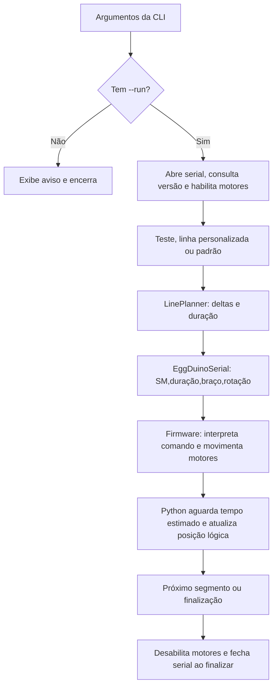
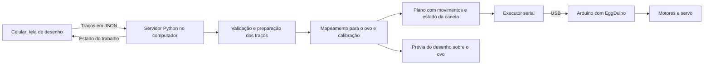

# Egg-Bot — contexto técnico para GPT e desenvolvimento

> **Levantamento histórico, anterior à interface React e à reorganização para o GitHub.** As árvores, pendências e descrições abaixo registram aquela revisão. Para o estado atual, consulte o [README principal](../README.md) e o [índice de documentação](README.md). Os links para arquivos foram ajustados aos caminhos atuais.

Este documento mapeia o código local e suas entradas e saídas para orientar a evolução do projeto: **desenhar no celular, converter os traços em movimentos e enviar ao Arduino para desenhar na superfície de um ovo**.

Levantamento realizado em 21/09/2026. As seções de funcionamento descrevem a implementação encontrada; as seções de evolução são propostas ainda não implementadas. O código local é a referência quando houver divergência com comentários ou READMEs antigos.

## 1. O que existe hoje

O projeto controla dois motores de passo: um gira o ovo (`rotation`) e outro movimenta o braço da caneta (`arm`). O firmware também controla um servo para levantar/baixar a caneta. Esse servo ainda não foi integrado ao pré-plotter Python.

Há dois caminhos independentes:

- **Pré-plotter por terminal:** gera padrões ou recebe uma linha em coordenadas dos motores, calcula deslocamentos e duração e envia comandos pela serial. É a base mais direta para a futura integração com o celular.
- **Driver do Inkscape:** `eggbot.py` processa SVG e usa bibliotecas externas do ecossistema EggBot. Ele não é importado pelo pré-plotter e não é um servidor para celular.

Não há aplicação móvel, interface web, API HTTP, importador de desenhos no pré-plotter, visualização 3D ou modelo geométrico do ovo. O firmware local usa serial; não há comunicação Wi-Fi/Bluetooth implementada.

Neste objetivo, “2D para 3D” significa **mapear um desenho plano sobre uma superfície curva**. Os movimentos continuam sendo rotação do ovo e movimento do braço, com levantamento da caneta. Não existe um eixo cartesiano Z contínuo no código atual.

## 2. Mapa do repositório

```text
Egg-Bot/
├── README.md                     Apresentação e comandos básicos
├── README_GPT.md                 Este mapa técnico e proposta de evolução
├── requirements.txt              Atualmente contém Markdown; instalação precisa de correção
├── preplotter/
│   ├── __init__.py               Metadados do pacote, versão 0.1.0
│   ├── main.py                   CLI e classe coordenadora PrePlotter
│   ├── patterns.py               LineSegment e PatternGenerator
│   ├── planner.py                MoveCommand e LinePlanner
│   ├── eggduino.py               EggDuinoSerial: transporte serial
│   ├── README.md                 Guia resumido do pré-plotter
│   └── __pycache__/              Bytecode gerado; não é código-fonte
├── exemplos_padroes.py           Demonstra geração, combinação e estimativa de padrões
├── eggbot.py                     Driver independente para Inkscape, versão indicada 2.8.5
├── eggbot_conf.py                Configuração exclusiva do driver Inkscape
├── EggDuino-master/
│   ├── EggDuino.ino              Configuração, pinos, setup, loop e registro de comandos
│   ├── Functions.ino             Implementação dos comandos do protocolo
│   ├── Helper_Functions.ino      Movimento, ACK, EEPROM e habilitação dos motores
│   ├── SerialCommand.h/.cpp      Parser serial com separação por vírgulas
│   ├── AccelStepper.h/.cpp       Biblioteca de controle dos motores
│   ├── button.h                  Suporte a botões opcionais
│   ├── README.md                 Instruções históricas do firmware
│   ├── VersionHistory.txt        Histórico do firmware
│   └── LICENSE.md                Licença do firmware
├── capa.jpeg / imagem02.jpeg     Imagens de documentação
└── .gitmessage                   Modelo de mensagem de commit
```

No levantamento, `EggDuino-master/` existe localmente, mas aparece como **não rastreado pelo Git**. Um clone do conteúdo já versionado pode não incluir esse firmware. Não confundir com `EggDuino/`, nome usado no README antigo.

## 3. Fluxo de execução atual



Em [preplotter/main.py](../preplotter/main.py), `main()` interpreta os argumentos. Sem `--run`, retorna antes de criar o controlador: **não abre a serial, não calcula o desenho e não produz prévia**. O nome “modo de simulação” nos logs representa apenas esse bloqueio de execução.

Com `--run`, `PrePlotter.prepare()` conecta, envia `v` e depois `EM,1`. A escolha é feita nesta ordem: padrão (`--pattern`), linha personalizada (quando há `--start-rotation`) e teste (`--test`). Em `finally`, `cleanup()` tenta enviar `EM,0` e fechar a conexão, inclusive após falhas de preparação.

`execute_pattern()` percorre os segmentos e chama `plot_line()` para cada um. `plot_line()` calcula o comando, envia, espera a duração mais uma margem de 0,5 segundo e atualiza `current_rotation`/`current_arm` com o destino solicitado. Essas posições são estimativas em memória; não são leituras de sensores.

## 4. Entradas e saídas por componente

| Componente | Entrada | Saída e efeitos |
| --- | --- | --- |
| `main.parse_arguments()` | Argumentos do terminal | Configuração da execução via `argparse` |
| `PatternGenerator` | Parâmetros geométricos em passos, amostragem e velocidade | `list[LineSegment]`, sem acesso ao hardware |
| `LinePlanner.plan_line()` | Início/fim `(rotation, arm)` e velocidade | `MoveCommand`; lança `ValueError` para determinadas entradas inválidas |
| `PrePlotter.plot_line()` | Coordenadas inicial/final e velocidade | `bool`, logs, comando serial, espera e atualização de posição lógica |
| `EggDuinoSerial.send_command()` | Texto de comando sem terminador | Envia bytes com `\r`; devolve uma linha de resposta, `""` em timeout ou `None` em certos erros/sem leitura |
| Métodos `move`, `enable_motors`, `disable_motors` | Movimento ou ação solicitada | `bool` baseado na existência de uma resposta |
| Firmware EggDuino | Comandos ASCII pela serial | Pulsos STEP/DIR, habilitação dos drivers, controle de servo e respostas seriais |
| `eggbot.py` | Documento SVG e opções da extensão Inkscape | Comandos via `plotink`, mensagens e atualização de metadados de plotagem no SVG |
| `exemplos_padroes.py` | Parâmetros escritos no próprio script | Exemplos e estimativas impressos; não executa movimentos |

A CLI retorna `0` quando conclui ou quando não recebe `--run`, e `1` nas falhas tratadas pelo fluxo principal. Erros de argumentos são tratados pelo `argparse`. O pré-plotter não salva arquivos de desenho, planos, imagens ou histórico de execução.

### Coordenadas e estruturas

```python
LineSegment(start_rotation, start_arm, end_rotation, end_arm, speed)
MoveCommand(rotation_steps, arm_steps, duration_ms)
```

`LineSegment` é uma `NamedTuple` com cinco campos; `MoveCommand` é uma `dataclass`. As coordenadas dos segmentos são posições em **passos do sistema de comando**, aceitas como `float`. A velocidade usa passos/segundo e a duração usa milissegundos. Não são pixels, milímetros nem coordenadas XYZ.

O planejador usa:

```text
dr = end_rotation - start_rotation
da = end_arm - start_arm
distância = sqrt(dr² + da²)
duração_ms = max(10, int(1000 × distância / speed))
passos enviados = int(dr), int(da)
```

Ele exige velocidade positiva e limita o módulo do delta de cada eixo a 100000. A constante `MIN_SPEED = 1` existe, mas não é aplicada: velocidades entre 0 e 1 são aceitas. Distância zero produz `(0, 0, 10 ms)`. Não há validação completa de `NaN`, infinito, velocidade máxima ou duração máxima.

Exemplo verificável sem Arduino:

```python
from preplotter.planner import LinePlanner

move = LinePlanner.plan_line(0, 0, 800, 0, 400)
print(move)  # MoveCommand(rot=800, arm=0, dur=2000ms)
print(f"SM,{move.duration_ms},{move.arm_steps},{move.rotation_steps}")
# SM,2000,0,800
```

**A ordem muda na serial:** a estrutura de planejamento apresenta rotação antes do braço, mas `move()` e o comando `SM` recebem braço antes de rotação.

### Padrões disponíveis

| Opção CLI | Gerador | Construção e quantidade de segmentos |
| --- | --- | --- |
| `sine` | `sine_wave()` | Rotação linear e braço senoidal; `num_points - 1` |
| `multi-sine` | `multi_sine_wave()` | Rotação linear e vários períodos no braço; `num_points - 1` |
| `spiral` | `spiral()` | Rotação linear e braço com rampa mais seno de amplitude fixa 200; `num_points - 1` |
| `square` | `square()` | Quatro lados; `size` é metade do lado no código |
| `circle` | `circle()` | Aproximação poligonal fechada; `num_points` |
| `star` | `star()` | Raios interno/externo alternados; `2 × num_points` |

Os nomes descrevem formas no espaço `(rotation, arm)`. A aparência na casca depende da mecânica e da geometria do ovo. No gerador `spiral`, `num_turns` controla a oscilação do braço; não multiplica o deslocamento de rotação por esse número.

Os métodos `pattern_*()` de `PrePlotter` escolhem valores próprios, que podem diferir dos padrões das funções geradoras. `--speed` é utilizado na linha personalizada; testes e padrões da CLI usam velocidades definidas no código.

## 5. Serial e firmware local

Referências: [eggduino.py](../preplotter/eggduino.py), [Functions.ino](../firmware/uno/EggDuino/Functions.ino), [Helper_Functions.ino](../firmware/uno/EggDuino/Helper_Functions.ino) e [SerialCommand.cpp](../firmware/uno/EggDuino/SerialCommand.cpp).

- Taxa padrão: **9600 baud**, tanto no Python quanto em `Serial.begin(9600)`.
- Comandos são texto separado por vírgulas e terminado por **`\r`**.
- Respostas do firmware terminam em `\r\n`. O Python usa `readline()` e `strip()`.
- O Python espera 2 segundos após abrir a porta, tem timeout de leitura padrão de 2 segundos e pausa de 50 ms após cada escrita.
- Mudar `--baud` só altera o lado Python; o firmware precisa usar a mesma taxa.

| Comando | Comportamento no firmware local | Uso pelo pré-plotter |
| --- | --- | --- |
| `v` | Retorna `EBBv13_and_above Protocol emulated by Eggduino-Firmware V1.6a` | Detecção |
| `EM,1` / `EM,0` | Habilita/desabilita os drivers; responde `OK` | Preparação/finalização |
| `SM,duration_ms,arm_steps,rotation_steps` | Agenda deslocamentos relativos; responde `OK` antes de terminar o movimento | Plotagem |
| `SP,0[,espera_ms]` | Move servo para posição de caneta levantada | Ainda sem integração |
| `SP,1[,espera_ms]` | Move servo para posição de caneta abaixada | Ainda sem integração |
| `TP[,espera_ms]` | Alterna a posição da caneta | Ainda sem integração |
| `QP` | Retorna `1` para levantada ou `0` para abaixada, seguido de `OK` em outra linha | Ainda sem integração |
| `SC,4,valor` / `SC,5,valor` | Configura posição abaixada/levantada e grava na EEPROM | Ainda sem integração |

Esses significados de `SP` foram lidos de `setPen()` no firmware local; não assumir que outro firmware segue a mesma convenção. `SC` converte o valor recebido para posição do servo pela expressão `(valor - 6000) / 133.3`: não passar graus diretamente. A inicialização carrega as posições da EEPROM, sobrescrevendo os valores iniciais do código.

Também há comandos de camadas e contadores (`SL`, `QL`, `SN`, `QN`, `NI`, `ND`), consulta de botão (`QB`) e comandos ignorados com ACK (`SE`, `PO`). Eles não constituem uma API de progresso físico do pré-plotter.

`stepperMove()` espera terminar o movimento anterior, interpreta o próximo e envia o ACK antes de chamar `prepareMove()`. O `loop()` gera passos com `runSpeedToPosition()`. **`OK` confirma aceitação, não conclusão física.** A espera do Python é estimada, sem confirmação de posição.

### Pinos e parâmetros definidos no sketch

| Função | Valor no código |
| --- | --- |
| STEP / DIR da rotação | 2 / 5 |
| STEP / DIR do braço | 3 / 6 |
| ENABLE dos dois drivers | 8, ativo em nível baixo |
| Servo da caneta | 4 |
| Microstepping declarado | 16 para ambos os eixos |
| Velocidade máxima configurada na biblioteca | 2000 passos/s por eixo |

Os pinos e o microstepping precisam corresponder à montagem. O firmware converte passos do protocolo conforme `16 / rotMicrostep` e `16 / penMicrostep`; com os valores locais, o fator é 1. Não há homing por sensor nem detecção de colisão implementados. A referência inicial é a posição de partida da máquina.

## 6. Caminho independente do Inkscape

[eggbot.py](../eggbot.py) contém a classe `EggBot(inkex.Effect)` e executa `e.affect()` ao final. Seu fluxo percorre o SVG, aplica transformações, converte formas em caminhos e subdivide curvas em segmentos. `plotPath()` trata deslocamentos entre traços e estado da caneta; `plotLineAndTime()` calcula passos/tempo e usa `ebb_motion.doXYMove()`.

O driver também contém seleção de camadas, pausa/retomada, inversão de motores e metadados de progresso no SVG. Texto e imagens raster precisam ser convertidos em caminhos para plotagem; o driver emite avisos para esses elementos.

As dependências importadas incluem `lxml`, `plot_utils_import`, `plotink`, `ink_extensions` e `ink_extensions_utils`. Elas não acompanham integralmente este repositório e não são cobertas apenas por `pyserial`. Não assumir que `python eggbot.py` funciona isoladamente.

[eggbot_conf.py](../eggbot_conf.py) define página de referência `3200 × 800`, `STEP_SCALE = 2` e `MIN_GAP = 1.0`. **O pré-plotter não importa essa configuração.** Alterá-la não muda os padrões ou limites de `preplotter/`. O valor 3200 não deve ser adotado como calibração comprovada da montagem apenas por aparecer no código.

## 7. Como executar e verificar sem hardware

O `requirements.txt` atual contém títulos, explicações e blocos Markdown, portanto não é uma lista válida de requisitos para `pip install -r`. Até sua correção, a dependência externa do pré-plotter pode ser instalada diretamente:

```bash
python3 -m venv .venv
source .venv/bin/activate
python3 -m pip install 'pyserial>=3.5'
python3 -B -m preplotter.main --help
python3 -B -m preplotter.main --pattern circle
python3 -B exemplos_padroes.py
```

Execute a partir da raiz do repositório. O pacote usa imports relativos; prefira `python3 -m preplotter.main`. O pré-plotter usa `dataclasses`, disponível na biblioteca padrão a partir do Python 3.7; o levantamento foi verificado com Python 3.11.11 e PySerial 3.5, sem comprovar outras combinações.

Com hardware preparado, os comandos abaixo **executam movimento real**:

```bash
python3 -m preplotter.main --port /dev/ttyACM0 --run --test reference
python3 -m preplotter.main --port /dev/ttyACM0 --run --pattern circle
python3 -m preplotter.main --port /dev/ttyACM0 --run \
  --start-rotation 0 --start-arm 0 \
  --end-rotation 500 --end-arm 300 --speed 200
```

Testes disponíveis na CLI: `reference`, `return`, `arm`, `diagonal`, `all`. São rotinas de movimentação, não uma suíte automatizada de testes. Executar `return` isoladamente envia -800 passos de rotação; não procura uma origem física.

## 8. Lacunas que afetam o desenho enviado pelo celular

1. **Posicionamento inicial ausente.** `plot_line()` usa o início informado apenas para calcular o delta. Não move primeiro até esse início nem confere se corresponde à posição corrente. Um círculo que começa em `(1900, 400)` não faz o robô chegar ali antes de desenhar. Combinar listas de padrões também não cria movimentos de transição.
2. **Traços separados sem controle de caneta.** `LineSegment` não registra caneta levantada/abaixada, e o pré-plotter não envia `SP`. Será necessário levantar, viajar até o início de cada traço, baixar, desenhar e levantar novamente.
3. **Perda de precisão.** Cada delta é truncado com `int()`, sem acumular resíduos. Muitos segmentos pequenos podem perder deslocamento; um delta `(0.9, 0.9)` vira `(0, 0)`. A posição lógica ainda é atualizada para o destino solicitado.
4. **Resposta serial pouco validada.** Qualquer texto não vazio é tratado como sucesso, inclusive `unknown CMD`. A detecção de versão também aceita qualquer resposta não vazia. Consultas como `QP` devolvem duas linhas; o leitor atual consome apenas uma e pode deixar uma resposta para o próximo comando.
5. **Limites incompatíveis entre camadas.** O limite Python de 100000 passos não é um limite válido garantido para o firmware. Este recebe passos em `int` e duração em `uint16_t`, mas converte o texto com `atoi`. Ao preparar o alvo UNO, revisar os limites efetivos dos tipos/conversões e dividir movimentos longos; não basta considerar apenas a faixa nominal de `uint16_t`.
6. **Ausência de limites mecânicos e calibração.** Não existe perfil com passos por volta, relação do braço com a posição na casca, sentidos, origem, tamanho do ovo e área alcançável. Padrões podem produzir coordenadas negativas ou fora do alcance.
7. **Estimativa de tempo incompleta.** A duração geométrica não inclui a espera adicional de 0,5 s por segmento, comunicação e servo futuro. A distância euclidiana em passos não representa distância física uniforme sobre o ovo.
8. **Cancelamento e recuperação limitados.** A CLI captura `Ctrl+C` e tenta desabilitar os drivers. Isso não implementa pausa/retomada, parada coordenada com levantamento da caneta ou recuperação da posição após reset/desconexão.
9. **Infraestrutura de desenvolvimento incompleta.** Não foi encontrada suíte automatizada; existem bytecodes versionados. O link antigo para `docs/preplotter.md` apontava para um arquivo ausente. As declarações históricas de testes no hardware não foram revalidadas neste levantamento.

## 9. Arquitetura proposta: celular → desenho no ovo

Esta seção é uma proposta para a próxima etapa, não uma descrição de recursos prontos.



Uma primeira implementação pode manter o computador conectado ao Arduino por USB. O celular abre a interface do servidor pela rede local. Isso permite reaproveitar o caminho serial existente. Comunicação direta celular–Arduino exigiria definir uma conexão compatível e implementar outro transporte; não está disponível hoje.

Separar responsabilidades facilita comparar a prévia com a execução:

| Camada proposta | Entrada | Saída |
| --- | --- | --- |
| Tela de desenho | Gestos de toque | Lista ordenada de traços, preservando cada levantamento do dedo |
| Recepção do trabalho | JSON versionado | Desenho validado, identificador e estado do trabalho |
| Preparação | Pontos de cada traço | Polilinhas simplificadas/amostradas, sem ligar traços independentes |
| Mapeamento | Coordenadas 2D e perfil de calibração | Posições de rotação/braço e pontos 3D para prévia |
| Planejamento | Posições e limites | Sequência de levantar, viajar, baixar, desenhar e esperar |
| Execução | Plano validado | Comandos seriais, progresso estimado e erros |

O servidor deve manter um único executor proprietário da porta serial e serializar os trabalhos. Progresso de comandos enviados/aceitos deve ser distinguido de movimento fisicamente concluído.

### Contrato sugerido para o desenho

Exemplo de formato futuro; nenhum módulo atual aceita esse JSON:

```json
{
  "schema_version": 1,
  "coordinate_system": "normalized_top_left",
  "canvas": {"width": 1000, "height": 600},
  "calibration_id": "ovo-perfil-01",
  "strokes": [
    {"points": [[0.1, 0.2], [0.2, 0.3], [0.3, 0.2]]},
    {"points": [[0.6, 0.5], [0.7, 0.6]]}
  ]
}
```

Os pontos são `[u, v]` normalizados entre 0 e 1, com origem no canto superior esquerdo. `canvas` registra as dimensões originais e sua proporção; não altera a unidade dos pontos. Cada elemento de `strokes` representa um traço contínuo. Entre elementos, a caneta deve subir. O servidor resolve `calibration_id` para um perfil próprio; não confunde pontos da tela com passos de motor.

A validação deverá conferir versão, números finitos, faixa de coordenadas, tamanho máximo do trabalho e traços com pelo menos dois pontos, além de definir como tratar toques isolados. Velocidade, região de impressão e modo de ajuste da proporção devem ser opções explícitas do trabalho/perfil. Não há controle contínuo de pressão da caneta implementado.

### Conversão 2D para a superfície

Para um primeiro protótipo, delimitar uma faixa desenhável e usar um mapeamento calibrado:

```text
rotation_target = rotation_origin + direction_rotation × u × rotation_span_steps
arm_target      = arm_origin      + direction_arm      × v × arm_span_steps
```

As origens, amplitudes e sinais vêm da calibração. Esse mapeamento usa o desenho como coordenadas de uma faixa da casca e pode gerar distorção; não representa compensação geométrica completa. A aplicação deve definir se preserva proporção com margens ou estica o desenho.

Para uma prévia 3D, uma possível representação é uma superfície de revolução com perfil medido `r(z)`:

```text
theta = theta_origin + u × theta_span
z     = z_min + v × (z_max - z_min)
P(u, v) = (r(z) × cos(theta), r(z) × sin(theta), z)
```

Essa fórmula é uma proposta de visualização. Um ovo real não precisa coincidir com uma esfera ou elipsoide ideal, e a altura `z` não fornece diretamente os passos do braço. A relação entre o contato na casca e o mecanismo do braço precisa ser medida ou modelada. Não enviar XYZ ao firmware, que espera deslocamentos dos dois motores.

Para melhorar a correspondência física, evoluir para uma tabela/modelo calibrado de contato, compensação de distorção e velocidade em função do percurso na superfície. Definir também a emenda de uma volta completa, a região próxima às extremidades e os limites mecânicos. A prévia e o plano enviado devem usar o mesmo perfil de calibração e a mesma política de mapeamento.

### Ordem sugerida de implementação

1. Corrigir a instalação e estabelecer um modo de planejamento sem hardware que exporte comandos/prévia. Verificar os limites e respostas do protocolo local.
2. Integrar o servo, posicionamento inicial, transições entre traços e controle de resíduos de quantização. Separar o planejador puro do executor serial.
3. Criar o perfil de calibração e o importador do contrato de traços; validar linhas, contornos fechados e dois traços separados.
4. Criar a tela de desenho no celular e a recepção dos trabalhos no computador; adicionar fila, estado e cancelamento definido.
5. Implementar a prévia 3D e refinar o mapeamento com medidas da máquina e do ovo.

Critérios de aceitação: dois traços separados não deixam uma linha de ligação; uma forma fechada não acumula erro significativo; movimentos fora dos limites são rejeitados antes do envio; erros de serial interrompem o trabalho; a prévia corresponde ao plano quantizado. Validar primeiro o plano sem hardware e depois a execução na montagem calibrada.

## 10. Contexto pronto para fornecer a outro GPT

> Estou desenvolvendo o Egg-Bot para desenhar no celular e reproduzir os traços em um ovo com Arduino UNO e firmware EggDuino. Leia `README_GPT.md` e os arquivos citados antes de alterar o código. A base atual é `preplotter/`: `patterns.py` gera `LineSegment`, `planner.py` calcula `MoveCommand`, `main.py` coordena e `eggduino.py` envia serial. O comando é `SM,duration_ms,arm_steps,rotation_steps\r`, em 9600 baud. Coordenadas atuais são passos, não pixels ou milímetros. O driver `eggbot.py` do Inkscape é independente. Ainda faltam entrada de traços, interface de celular, API, calibração geométrica, prévia 3D e integração do servo no pré-plotter. O firmware local tem `SP,0` para levantar e `SP,1` para baixar. Antes da integração, tratar posição inicial, transições, quantização, limites e validação de ACK. Preserve a distinção entre comportamento existente e proposta. Não suponha que o hardware foi calibrado nem que `OK` confirma movimento concluído. A primeira arquitetura proposta usa celular na rede local → servidor Python no computador → USB serial → Arduino.

## 11. Escopo da verificação deste documento

Foram lidos os fontes Python e os arquivos locais de protocolo/firmware. Foram executados `--help`, a CLI sem `--run` e exemplos de cálculo puro do planejador/geradores. O movimento de referência produziu `SM,2000,0,800`, e o comportamento de truncamento de passos fracionários foi confirmado.

Não foram abertos dispositivos seriais, executados movimentos, compilado/carregado o firmware ou testada a extensão Inkscape. Os pinos e comportamentos descritos correspondem ao código local, sem confirmação de que esse é o firmware instalado no Arduino.
